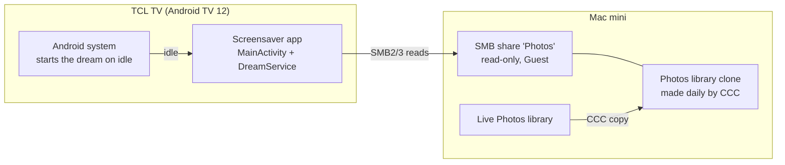
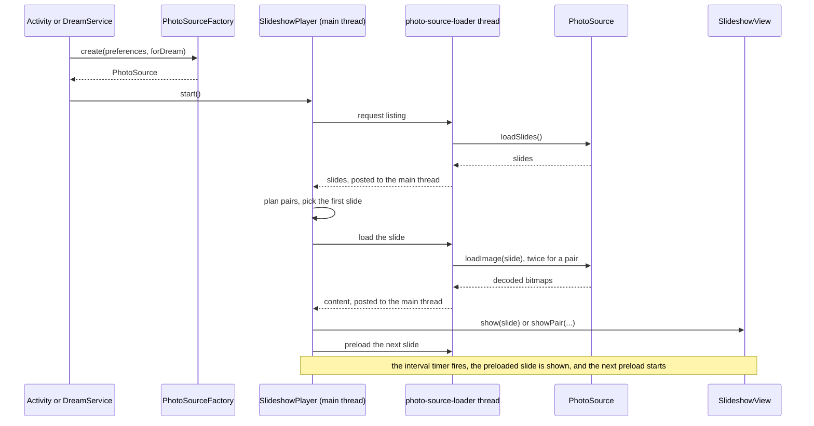
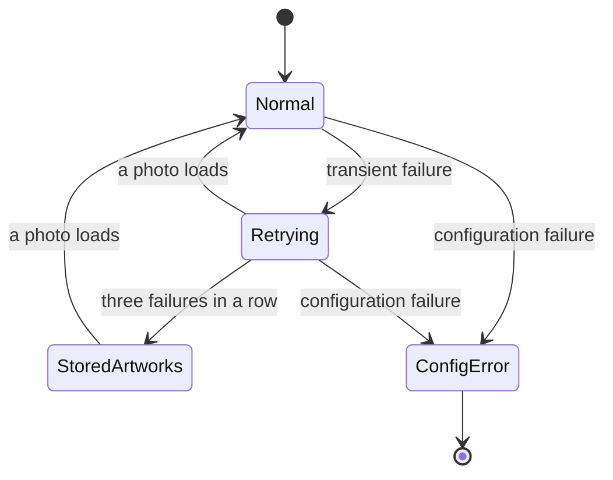

# Architecture

How the screensaver app is put together: what runs where, what is stored where, and how it fails. What the app does is in [product](PRODUCT.md); the per-feature designs are in [`engineering/`](engineering/). Statements marked **Unconfirmed** come from other docs or the journal and were not re-checked against the code when this was written.

## Contents

[Overview and glossary](#overview-and-glossary) · [Repository shape](#repository-shape) · [Runtime flow](#runtime-flow) · [Threads and lifecycle](#threads-and-lifecycle) · [Storage](#storage) · [Failure model](#failure-model) · [Build, modules, and dependencies](#build-modules-and-dependencies) · [Testing](#testing) · [Performance and memory](#performance-and-memory) · [Code map](#code-map) · [Data and privacy](#data-and-privacy) · [Platform dependency](#platform-dependency)

## Overview and glossary

The TV app reads photos and videos, read-only, from an SMB share on the Mac mini and shows them as a slideshow, either in a preview inside the app or as the system screensaver. It never writes to the share.

| Term | Meaning |
| --- | --- |
| Slide | One thing on screen: a photo, a video, or a pair of portrait photos (`Slide`). |
| Pool | The slides the player cycles through for one run. In *All* mode a random sample; in *Choose Albums* every usable photo in the selected albums. |
| Source | A `PhotoSource`: lists slides and loads one image or video at a time. Bundled samples or the SMB source. |
| Catalog | The TV's metadata-only JSON built from the Photos database: albums, videos, excluded and portrait paths. |
| Stage | The persistent local copy of `Photos.sqlite` and its WAL that the catalog is queried from. |
| Source ID | A SHA-256 hash of the normalized SMB location. It keys every cache, so a different location never reuses another's data. |
| Dream | The app's `DreamService`, the screensaver. |
| Prepared video | A clip whose end of file is local and whose download is expected to finish before it does. |

## Repository shape

`apps/screensaver/` is one standalone Android application. Future TV apps can be siblings under `apps/`. Avoid a shared Android module until more than one app actually needs the same code. `tools/` holds diagnostics and one-off scripts, and also the native HEIF decoder's CMake build (see [Build](#build-modules-and-dependencies)).

## Runtime flow

The settings activity and the dream build the same pieces from the same saved preferences: a `PhotoSource` from `PhotoSourceFactory`, an optional stored-artwork fallback source, a `SlideshowView`, and a `SlideshowPlayer` that connects them. They differ in three ways. The dream passes `forDream = true`, so a Type that includes videos becomes 500 random photos and the saved catalog is required (never built at idle). Only the activity passes a video stage. Both pass the pairing config when Layout is Portrait pairs.

- **Listing.** `loadSlides()` returns metadata only. In *All* mode it walks the tree and samples the pool; in *Choose Albums* it reads the saved catalog; with videos in scope it also draws from the catalog's video list.
- **Pairing.** After listing, `PairPlanner` joins some portrait photos into pair slides. A pair is loaded as two sequential decodes and laid out by `PairScene`.
- **Preload.** After a slide is shown, the player decodes the next photo while the current one stays up, so the screen never goes blank. A slide is shown only when it is fully ready.
- **Videos.** A video slide is prepared on the worker (`prepareVideo`) while the previous slide stays up, then handed to the `VideoSurfaceStage`. The interval is ignored while it plays; the next slide follows when it ends.
- **State.** Everything the player mutates lives on the main thread. A `generation` counter marks each run, and every callback checks it, so results from a stopped run are recycled instead of shown.

## Threads and lifecycle

| Thread | Owner | Does | Notes |
| --- | --- | --- | --- |
| Main | Android | Rendering, the `SlideshowScheduler` tick, all player state, preference reads | Callbacks reach it through `HandlerCallbackDispatcher` (main `Looper`) |
| `photo-source-loader` | `SlideshowPlayer` | Every `PhotoSource` call: listing, decoding, preparing videos | Single thread, daemon. Decodes one photo at a time, so a pair is two decodes |
| `fallback-photo-loader` | `SlideshowPlayer` | Loads the stored artworks | Separate so stored photos never wait behind an SMB timeout |
| Album executor | `MainActivity` | Catalog build and refresh, cover loading | Single thread, shut down in `onDestroy` |
| `photo-geocoder` | `PlaceNameResolver` | The blocking `Geocoder` call on Android 12 | Single daemon thread |
| `smb-close` | `SmbGuestPhotoSource` | Closes a connection without blocking the caller | Short-lived daemon thread |
| Video reader | `ProgressiveReader` | Sequential block download for one clip | **Unconfirmed:** one thread per clip, per the [video design](engineering/VIDEO_PLAYBACK.md) |

**Cancellation.** `stop()` bumps the generation, cancels the pending future, closes the source, and recycles prepared bitmaps. The SMB source keeps an `epoch` counter so a request that was interrupted by `close()` is treated as cancelled, not as a failure. Reader threads are never interrupted, because interrupting an SMB read breaks the connection; a clip is aborted by closing its connection from another thread.

**Lifecycle.**

- **Dream.** `onAttachedToWindow` builds the view and player. `onDreamingStarted` starts it, `onDreamingStopped` stops it, and `onDetachedFromWindow` disposes it (shuts down the executors and closes the source). The dream is non-interactive and never launches a sign-in flow.
- **Preview.** `enterPreview` creates a player; leaving the preview disposes it. `onPause` stops it and `onDestroy` disposes it. The preview keeps the screen on while it runs.
- **Work is released** when the dream or preview stops: timers cancelled, executors shut down on dispose, the SMB connection closed, bitmaps recycled.

## Storage

| What | Where | Lifetime | Keyed by |
| --- | --- | --- | --- |
| Settings | `SharedPreferences` file `slideshow` | Until app data is cleared | One set; the album selection is stored per source ID |
| Album catalog | `filesDir/photos-album-catalog-<sourceId>.json` | Persistent; replaced atomically on refresh | Source ID |
| Staged database and WAL | `filesDir/photos-db-stage/` (about 7.1 GiB at last measurement) | Persistent; resynced incrementally; cleared when a query fails | Source ID in its sync state |
| Album cover thumbnails | `filesDir/album-cover-thumbnails/<sourceId>/` | Persistent | Source ID |
| Video clip cache | `cacheDir/video-cache/` | One sparse file per clip, deleted on close; stale files purged at start | Not keyed |
| Image decode temps | `cacheDir/image-decode-temp/` | Bounded to 256 MB and 24 hours | Not keyed |

The catalog schema and its versions are in [album catalog and sync](engineering/ALBUM_CATALOG.md). `allowBackup` is off, so none of this is copied to a backup. A change of SMB host, share or library path produces a new source ID, and the old data is no longer used.

## Failure model

Every SMB error is classified (`SmbFailureKind`) and the player reacts to the class, not the exception.

| Class | Meaning | Player reaction |
| --- | --- | --- |
| `PER_FILE` | This photo or folder cannot be read or decoded | Drop the photo from the pool; keep going. An emptied pool triggers a new listing |
| `TRANSIENT` | The network, connection, or server was briefly unavailable | Keep the photo, move it to the back, wait a backoff (2, 4, 8, then 15 s), count it in the failure streak |
| `CONFIGURATION` | Retrying cannot help (Guest rejected, signing required, wrong share) | When listing: stop retrying and show an error message. Mid-session, on a single image, it is handled like a transient failure rather than emptying the pool |

- **Failure streak.** Counted failures are transient photo failures, transient listing failures, and video failures. Ordinary per-file photo skips are not counted. A fully loaded photo, or a video that reaches its end, resets the streak.
- **Stored artworks.** At three consecutive failures the fallback source shows the bundled artworks with the caption "SMB failure. Loading…" until a real photo loads. Without a fallback source, and with nothing on screen yet, the player shows a "Can't reach the photos right now" message instead.
- **Missing catalog.** If the saved catalog is missing or incompatible (`AlbumIndexException`), the player shows an error asking for a refresh in the app and does not retry. The dream never builds a catalog itself.
- **Connection reuse.** The SMB source keeps one connection. A failure that implies a broken connection discards it, and a failure on a reused connection retries once on a fresh one.
- **Videos.** A clip that cannot play is dropped; one that was only too slow or stalled goes to the back to be retried. A lone clip is retried after a backoff.
- **Pairs.** If one photo of a pair fails, the other is shown alone and the failed one is dropped or kept by the same rules.

The user-facing behavior is in [product](PRODUCT.md#when-things-go-wrong); the SMB-specific causes are in [photo sources](PHOTO_SOURCES.md).

## Build, modules, and dependencies

The Gradle project is `apps/screensaver/` with two modules: `:app` (the application) and `:heif-probe` (a diagnostic app that lives in `tools/heif_tile_prototype/android`). Use `:app:lintDebug`; a plain `lintDebug` also checks `:heif-probe` and fails. The exact commands are in [device testing](DEVICE_TESTING.md#release-checklist).

| Decision | Value | Notes |
| --- | --- | --- |
| Application ID | `com.googletv.screensaver` | The screensaver setting stores `package/class`, so keep it stable. |
| `minSdk` | 31 | The TV runs Android TV 12 (API 31). Personal app; older devices are not supported. |
| `targetSdk`, `compileSdk` | 34, 37 | Check official Android guidance before changing. |
| Android Gradle Plugin | 9.2.0 | Gradle 9.4.1 with a checksum-pinned wrapper. Kotlin comes from AGP's built-in support; no separate Kotlin plugin version is set. |
| UI toolkit | Android Views | `DreamService` is not a `LifecycleOwner`, so one plain `View` renders in both the activity and the dream. |
| SMB client | SMBJ 0.15.0 | SMB2/3 with explicit Guest. SMBJ rejects Guest when the server requires signing, so the Mac mini's signing requirement is off ([the server change](../journal/2026-10-12-1729-mac-mini-signing-change.md)). |
| Native HEIF decoder | libheif and libde265, built by CMake | Pinned to Git commits in `tools/heif_tile_prototype/CMakeLists.txt`. **Unconfirmed:** libheif 1.23.5 and libde265 1.1.3, per the journal. |
| ABI | `armeabi-v7a` only | The TV does not accept ARM64-only APKs. NDK 28.2.13676358, CMake 3.31.6. |
| Image decoding | Sampled `BitmapFactory` or `ImageDecoder`; native tile decoder for HEIF images of 24 MP and above | EXIF orientation is applied in the shared decode path. |
| Test dependencies | JUnit 4.13.2, `org.json` 20250517 | The real `org.json` is needed because `android.jar` only has stubs. |
| Permissions | `INTERNET` only | `leanback` is required; touchscreen is not. |

The build stamps the settings screen with `BUILD_TAG` (the short Git commit, with `-dirty` if the tree has changes) and `BUILD_TIME`. No other dependencies are used; do not add one without checking current official documentation.

## Testing

- **JVM unit tests only.** The tests live in `app/src/test/`; there are no instrumented (`androidTest`) tests. Run them with `:app:testDebugUnitTest`.
- **Logic is kept out of Android classes** so it can be tested on the JVM: the planners and rules (`PairPlanner`, `PairFit`, `PairFailureRules`, `VideoFailureRules`, `SlideMixer`, `MediaTypeRules`), the SMB error classification, the path and catalog parsing, the buffer safeguard, and the progressive reader's gate maths.
- **Seams for the player.** `SlideshowPlayer` takes an injectable clock, callback dispatcher, worker executors and logger, so tests drive failures and timing deterministically.
- **Database fixtures.** The WAL and stage tests use a SQLite-generated WAL fixture (`app/src/test/resources/sqlite-generated.wal`) plus in-memory remote files, including injected mid-copy failures and checksum corruption.
- **What only the TV can show:** real SMB behavior, decode time and memory, video playback, idle activation of the dream, and anything visual. Those checks are recorded as journal entries (see [device testing](DEVICE_TESTING.md#release-checklist)).

## Performance and memory

- **Decode to the screen size.** Photos are decoded to fit the display (a 12 MP landscape is decoded at 1008 × 756), never at full resolution, except through the native tile decoder for 24 MP and larger HEICs.
- **One decode at a time, one slide ahead.** The worker is a single thread and the player preloads exactly one upcoming slide, so at most the current slide, one preloaded slide and a pair's background are held.
- **Native bitmaps.** On Android 8 and later bitmap pixels are in native memory, so process memory (PSS) is the figure to watch, not the managed Java heap alone. **Unconfirmed:** the 192 MB managed-heap limit mentioned in the [portrait pairs design](engineering/PORTRAIT_PAIRS.md#rendering-and-performance).
- **Measured, not guaranteed.** A 31-minute portrait-pairs soak stayed between 91 and 141 MB PSS, a 60-minute video soak stayed at 80 to 101 MB ([hardening entry](../journal/2026-10-18-0959-hardening-milestone-7.md)), and a later album-picker sweep raised PSS from about 88 MB to 203 MB, which was accepted ([journal](../journal/2026-10-19-2007-resource-cleanup-follow-up.md)). Longer soaks have not been done.
- **Bandwidth.** The SMB link sustained roughly 6 to 10 MB/s in measurements, and parallel reads were slower, so the app uses one connection and one sequential reader per clip, and does not fetch the next clip while one downloads.

## Code map

Package `com.googletv.screensaver`:

| Area | Files | Role |
| --- | --- | --- |
| Settings and picker UI | `MainActivity`, `SlideshowPreferences`, `AlbumCoverRules` | Remote-friendly settings, the album carousel, and persisted preferences |
| Renderer | `SlideshowView`, `VideoSurfaceStage`, `VideoFit`, `PairBackground`, `PairColors` | One view shared by the activity and the dream; video surface; the pair background |
| Dream | `dream/SlideshowDreamService` | System screensaver entry point |
| Player | `playback/SlideshowPlayer`, `SlideshowScheduler`, `SlideMixer`, `PairPlanner`, `PairFit` | Scheduling, preloading, photo and video mix, and portrait pairing |
| Sources | `playback/PhotoSource`, `PhotoSourceFactory`, `SmbGuestPhotoSource` | Bundled samples and the read-only SMB Guest source |
| Catalog | `playback/PhotosAlbumCatalog`, `AlbumCatalogMapper`, `PathSet`, `PortraitRules`, `DatabaseStage`, `WalFrameScanner` | The TV-cached album catalog and the staged, incrementally synced Photos database |
| Video | `playback/ProgressiveReader`, `SmbRemoteVideo`, `VideoPlayback`, `VideoPoster`, `VideoSafeguard` | Progressive download, playback and poster frames |
| Images and labels | `playback/NativeHeifDecoder`, `HeifCanvas`, `PlaceNameResolver` | 24 MP HEIC tile decoding and best-effort place names |

The failure rules (`PairFailureRules`, `VideoFailureRules`, `SmbErrors`) and the planners are plain Kotlin so they run in JVM tests. Design docs for the larger features: [album catalog and sync](engineering/ALBUM_CATALOG.md), [video playback](engineering/VIDEO_PLAYBACK.md), and [portrait pairs](engineering/PORTRAIT_PAIRS.md); the behavior they implement is in [product](PRODUCT.md).

## Data and privacy

- **Read-only.** No write-capable file handles are opened on the share. The Photos database is never opened over SMB; a staged local copy is queried read-only.
- **Sources.** Bundled local images provide the demo and fallback source. In **All** mode, the SMB source enumerates supported files below `Photos Library.photoslibrary/originals/`, filters exclusions, and samples the requested pool for the current run; it does not persist a whole-tree index. In **Choose Albums** mode, the TV reads the source-bound catalog and uses its saved album membership. Internal Photos package directories are never presented as albums.
- **Authentication.** Use explicit Guest mode with no saved username or password. Anonymous access and an arbitrary username with a blank password are not equivalent. SMBJ connects only because the Mac mini's signing requirement is off.
- **Logging.** Never log photo filenames or host addresses. Logs carry counts, timings and failure classes under a few tags (`PhotoSource`, `AlbumPicker`, `Settings`, `PairScene`).
- **Cache keys.** The source ID is a hash, so no host, share or path appears in a cache file name.
- **Clone.** The shared library is a clone of the live `LIVE_VOLUME` library on a second external drive. If the drive sleeps or is not mounted, the app reports an unavailable source and retries transient errors rather than presenting an empty library. A persistent All-mode index and periodic background refresh are deferred. Any new image cache on the TV needs an explicit size and retention policy.
- **Location labels.** For **Location + date** labels, EXIF GPS coordinates are sent to Android's built-in Geocoder for a best-effort place name. This may involve Android's network-backed geocoding provider, so place-name availability and accuracy depend on the TV and its connectivity. A missing provider, empty result, timeout, or lookup error leaves the coordinate label in place. **No label** never requests geocoding. Results are cached in memory for the current run; no coordinates or resolved names are persisted. Android 12 / API 31 uses the older blocking API on a separate background executor; API 33 and later use the callback API. [Android Geocoder reference](https://developer.android.com/reference/android/location/Geocoder)
- **EXIF.** EXIF is read from at most the first 512 KiB of each photo, copied into a memory stream and discarded after the label is built; Android's EXIF reader returned nothing when given the SMB network stream directly ([journal](../journal/2026-10-12-2250-exif-prefix-read.md)).

## Platform dependency

Android provides `DreamService`; on this TCL firmware, third-party selection uses `adb shell settings put secure screensaver_components`. The app dream activated at the default 10-minute timeout, including after a TV restart (restart result user-reported). No separate TCL Auto Launch control was found or needed in observed runs. The TCL's idle Art Mode is separate from Google's Ambient mode; the current firmware's behavior is recorded in [device testing](DEVICE_TESTING.md#device-findings). Recheck after firmware updates and keep the launcher preview available.
